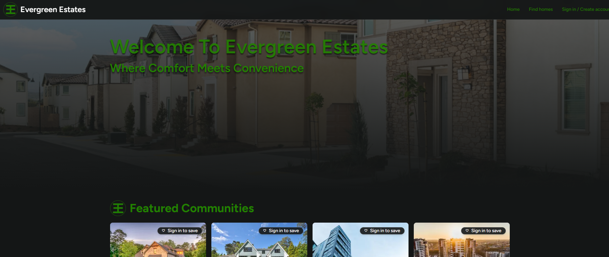
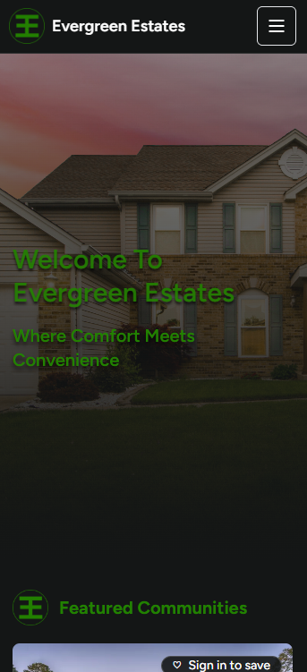
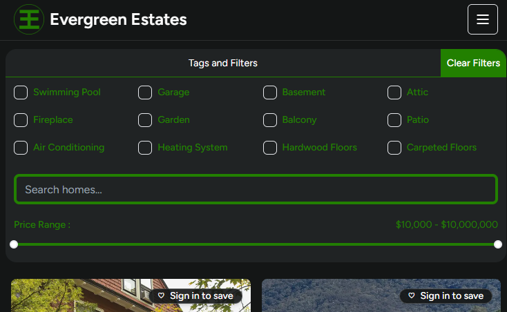
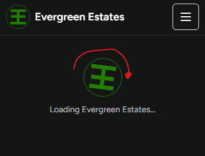

# Evergreen Estates

Evergreen Estates is a full-stack real-estate marketplace built with Next.js, TypeScript, PostgreSQL, and Supabase. It supports public property discovery, URL-driven search and filtering, seller storefronts and listing management, reviews, saved homes, account preferences, authentication, and private listing media.

**Links:** [Live demo](https://evergreen-estates.netlify.app/) · [GitHub repository](https://github.com/BryanReyes-dev/Evergreen-Estates) · [Figma design](https://www.figma.com/design/SY5C36osUoFZLUtlRC3RDg/Evergreen-Estates?node-id=0-1&p=f&t=dISV54YArH5wU4rl-0)

## Screenshots

A quick look at the current interface across desktop and mobile, including the property search filters and loading experience.

### Home screen

| Desktop | Mobile |
|---|---|
|  |  |

### Search filters



### Loading experience



## Overview & Tech Stack

### Features in source

- Public property browse and detail pages, server-side search, and shareable URL-driven filters.
- Seller profiles, published seller storefronts, and owner-scoped listing create/edit/delete flows.
- Review display and author-scoped create/edit/delete flows.
- Better Auth email/password sign-up, sign-in, session, sign-out, email verification, and password reset.
- Optional demo signup bypass for development, with scheduled 24-hour cleanup of temporary accounts and owned content (disabled by default).
- Saved homes with persistent account state and a 100-listing limit.
- Account profile/avatar handling and saved browsing preferences.
- Supabase Storage listing media for images, GIFs, and videos, plus WebVTT video captions; private objects are delivered through signed URLs.
- Server-rendered pages with focused Client Components for interactive behavior.

The capabilities above are visible in the current source. They should not be interpreted as proof that every browser workflow, authentication email, database permission, or Netlify production behavior has passed a fresh end-to-end check.

### Stack

| Area | Technologies |
|---|---|
| Application | Next.js 16 App Router, React 19, TypeScript |
| UI | Tailwind CSS, shadcn/ui, Base UI, Framer Motion, Embla Carousel, Hugeicons |
| Database | Supabase PostgreSQL, Drizzle ORM, Drizzle Kit, RLS |
| Authentication | Better Auth with the canonical public.users table |
| Media | Private Supabase Storage and server-issued signed URLs |
| Transactional email | Resend |
| Developer checks/tests | Vite+ (vp) with verbose Vitest-compatible tests |
| Hosting | Netlify, with production image optimization through Netlify Image CDN |

Vite+ is the development check/test workflow. Next.js remains the application framework and runtime.

## Development

### Requirements and setup

The package declares Node.js 24.22.1 and npm 11.19.1 through devEngines, matching the Node/npm versions shown in the Netlify build environment. Use the configured versions when possible.

Clone the repository and install dependencies:

    git clone https://github.com/BryanReyes-dev/Evergreen-Estates.git
    cd Evergreen-Estates
    npm install

Copy the environment template into a local ignored environment file and fill in values for the services you use:

    cp .env.example .env.local

Next.js loads .env.local; Drizzle Kit imports dotenv/config, which reads .env by default. For local migration commands, make sure DIRECT_URL is actually available to the process (for example, through an ignored local .env file or the shell). Never commit .env, .env.local, credentials, or generated fixture passwords.

Start the Next.js dev server:

    npm run dev

### Architecture and security boundaries

- DRIZZLE_DATABASE_URL is the read-only evergreen_runtime database connection for application reads.
- AUTH_DATABASE_URL is the restricted evergreen_auth connection for Better Auth data.
- APP_DATABASE_URL is the restricted evergreen_app connection for owner-scoped application writes.
- DIRECT_URL is a privileged Drizzle migration connection only; do not use it for request-time queries.
- Supabase JS is used for Storage operations, not as the application-table query layer.
- Keep secrets server-side. Only variables intentionally prefixed NEXT_PUBLIC_ should be exposed to the browser.
- Keep listing media in private Storage and use the existing signed-URL flow. GIF remains an image; MP4/WebM are videos; WebVTT is supported for video captions.

The full architecture and role boundaries are documented in [agents-files/ARCHITECTURE.md](./agents-files/ARCHITECTURE.md). Agent operating rules and current work status live in [agents-files/AGENTS.md](./agents-files/AGENTS.md) and [agents-files/Agents_Context.md](./agents-files/Agents_Context.md).

### Schema migrations

Migrations are versioned in drizzle/ and are applied using the privileged migration connection configured as DIRECT_URL. Review new SQL before applying it to a live database.

    vp exec drizzle-kit migrate

Never use the runtime read-only role or auth role for migrations. Do not edit the historical 0011_shared_read_role.sql migration or its Drizzle ledger row to force the known checksum/provenance discrepancy to disappear; migration 0021_reconcile_shared_read_role.sql is the forward-only reconciliation.

## Testing

Run test commands from the repository root with Vite+.

### One command for the complete test suite

Before opening a PR or reviewing a substantial change, run:

```sh
vp run test:all
```

This is the canonical all-tests command. It runs every discovered test file under `tests/**/*.test.ts`, covering deterministic unit tests, mocked API Route Handler tests, and read-only PostgreSQL permission integration tests. The suite runner explicitly enables the opt-in database tests for this command.

**Database requirement:** set `DRIZZLE_DATABASE_URL` in your local `.env` to the intended database using the restricted `evergreen_runtime` role. Before running, double-check that the URL points to the intended environment; the integration suite verifies the connected role's allowed and denied database permissions and performs no writes. Do not aim test commands at an unintended project.

The plain `vp test` command runs Vite+'s test runner directly and does not enable the opt-in database integration suite. Use `vp run test:all` when you need the complete current test suite in one command.

### Suite categories

| Command | What it runs |
|---|---|
| `vp run test:all` | All unit, API, and opt-in read-only database integration tests. |
| `vp run test:fast` | Unit tests and mocked API tests; no database connection. Use for a quick local feedback loop. |
| `vp run test:unit` | The deterministic tests under `tests/unit/`. |
| `vp run test:api` | Mocked HTTP Route Handler tests under `tests/api/`; authentication, database, and Storage dependencies are isolated. |
| `vp run test:integration` | Read-only PostgreSQL permission integration tests under `tests/integration/`; requires the restricted runtime connection. |

### Quality checks outside the test suite

The all-tests command runs tests; it does not replace formatting, linting, static/type checks, a production build, or real-browser checks. Run these separately when preparing a release:

```sh
# Formatting, lint, and static/type checks
vp check

# Same checks without the formatting stage
vp check --no-fmt

# Production Next.js build
npm run build
```

Automated tests currently run in Node. They do not by themselves verify browser playback, complete user journeys against the live site, verification/reset email delivery, or Netlify deployment health. Follow the relevant manual/browser and deployment checks as well.

### Focused test suites

Use a focused alias while developing to run only the relevant coverage. The detailed inventory—including each alias, the exact test file(s), and what each suite verifies—is maintained in [tests/README.md](./tests/README.md).

Examples:

```sh
vp run test:media-display
vp run test:saved-listings
vp run test:db-permissions
```

For a single isolated unit/API file, run `vp test run tests/path/to/file.test.ts`. To watch one file, use `vp test watch tests/path/to/file.test.ts`. Prefer the suite aliases documented in `tests/README.md` for the database integration tests so the runner configures the required opt-in flag.

## Production

### Netlify build configuration

The repository includes netlify.toml with the build command npm run build, publish directory .next, and an allowlist for the configured Supabase image host used by Netlify Image CDN. Netlify's current Next.js adapter supports App Router, server rendering, Route Handlers, and image optimization; the typical build settings are next build and .next, and the committed npm run build command invokes next build. See [Netlify's Next.js setup guide](https://docs.netlify.com/build/frameworks/framework-setup-guides/nextjs/overview/) and [Next.js build configuration values](https://docs.netlify.com/snippets/frameworks/nextjs-config-values/).

That is repository configuration, not proof of a successful Netlify build. Before promoting a deploy, verify the Netlify site is connected to the intended repository/branch, the preview build completes, environment variables are set for the right deploy contexts, and the production runtime works. Use a Deploy Preview before changing the public site.

### Environment variables

Copy the names from .env.example. Add values in Netlify's site environment-variable settings rather than committing them. Netlify supports context-specific values for Production, Deploy Previews, and branch deploys; use separate values when the preview and production environments should not share credentials or data. See the [Netlify environment-variable guide](https://docs.netlify.com/build/environment-variables/overview/) and [Deploy Previews guide](https://docs.netlify.com/deploy/deploy-types/deploy-previews/).

| Variable | Purpose | Handling |
|---|---|---|
| NEXT_PUBLIC_SUPABASE_URL | Supabase project URL | Public/client configuration |
| NEXT_PUBLIC_SUPABASE_ANON_KEY | Supabase public client key | Public/client configuration; keep RLS correct |
| SUPABASE_SECRET_KEY | Server-side Storage administration | Secret; never use in client code |
| DRIZZLE_DATABASE_URL | Read-only application reads | Secret; restricted evergreen_runtime login |
| AUTH_DATABASE_URL | Better Auth operations | Secret; restricted evergreen_auth login |
| APP_DATABASE_URL | Owner-scoped writes | Secret; restricted evergreen_app login |
| BETTER_AUTH_URL | Canonical deployed auth base URL | Public URL, not a secret; use the active production site origin |
| BETTER_AUTH_SECRET | Better Auth signing/encryption secret | Secret; use a strong unique value |
| ENABLE_DEMO_AUTH_BYPASS | Opt-in signup without email verification | Server-side boolean; leave false unless deliberately testing temporary demo accounts |
| RESEND_API_KEY | Verification/reset email delivery | Secret |
| AUTH_EMAIL_FROM | Verified sender used by Resend | Must use a sender/domain verified in Resend |
| DIRECT_URL | Drizzle migrations | Privileged; use in a controlled migration environment, not request-time application code |

Set BETTER_AUTH_URL to the canonical public site origin (currently https://evergreen-estates.netlify.app for the linked demo); a production value that points to localhost is incorrect because it can generate local authentication/email links. This URL is public configuration, not a secret: in Netlify, store it as a regular environment variable rather than marking it secret for secret-value scanning. If your Netlify site URL differs, use that site's actual origin. Verify preview origins separately. Configure and verify a Resend sender domain/address before expecting verification and password-reset emails to arrive. Do not put seed/credentials or fixture passwords in Netlify variables.

### Temporary demo accounts and automated expiry

`ENABLE_DEMO_AUTH_BYPASS=true` enables a visibly labeled demo signup path: email verification emails are skipped, new accounts receive an expiry at their original creation time plus 24 hours, and the success screen offers an explicit **Skip email verification and continue** button. The flag is disabled by default.

Migration `drizzle/0022_demo_account_retention.sql` adds the nullable `users.demo_expires_at` marker and a private database function that deletes only accounts whose marker has expired. It was applied to the connected Supabase project (`vcsotaclvwvbpqiljkuk`) on 2026-10-25. Live checks confirmed the column/function and confirmed that only `evergreen_auth` can execute the cleanup routine; no current users were marked for deletion and existing user/listing/review counts were unchanged.

The Netlify scheduled function in `netlify/functions/cleanup-demo-accounts.ts` runs every 15 minutes and handles up to five expired accounts per run. It queries expired demo candidates through the restricted `private.list_expired_demo_accounts(integer)` function, removes each eligible account's listing media/caption files and owned avatar first, then calls `private.delete_expired_demo_account(uuid)` to remove listings, seller profile, and user data (including dependent auth/review/saved-list data through database constraints/cascades). A Storage cleanup failure leaves the database account in place so a later scheduled run can retry. Both private routines are executable only by `evergreen_auth`; they are not exposed to browser-facing roles or the application-write role. Netlify Scheduled Functions run automatically only on published deploys, not Deploy Previews. The function's first live manual run on 2026-10-25 returned `found=0 deleted=0 skipped=0 failed=0`, confirming successful execution with no expired candidates; deletion has not yet been verified end-to-end. Set `AUTH_DATABASE_URL`, `APP_DATABASE_URL`, `NEXT_PUBLIC_SUPABASE_URL`, and `SUPABASE_SECRET_KEY` for the scheduled function.

Migration `0022_demo_account_retention.sql` adds the nullable expiry marker and private deletion routine; `0023_restricted_demo_account_lookup.sql` adds the restricted candidate lookup; and `0024_exclude_seed_accounts_from_demo_cleanup.sql` excludes the four canonical seed seller emails in both lookup and final deletion. These changes have been applied to the connected Supabase project (`vcsotaclvwvbpqiljkuk`). The demo signup hook also needs narrowly scoped database access to set its expiry marker: migration `0025_auth_demo_expiry_column_grants.sql` grants `evergreen_auth` only column-level `SELECT` and `UPDATE` permission on `public.users.demo_expires_at`, not broad `UPDATE` permission on the users table. Migration 0025 is registered in the Drizzle journal; run `vp exec drizzle-kit migrate` with the intended `DIRECT_URL` to synchronize the Drizzle ledger. Migrations 0023 and 0024 were applied outside the Drizzle journal and are represented in Supabase migration history. The cleanup only targets accounts with a non-NULL `demo_expires_at` at or before the current time; existing accounts with a NULL marker are not eligible. Keep `ENABLE_DEMO_AUTH_BYPASS=false` until migration 0025 is applied and deletion has been tested with a disposable demo account. Do not leave verification bypass enabled for a real production launch.

### Database and fixture safety

Recorded database verification from 2026-10-23 reports migration 0019 and the forward-only 0021 reconciliation applied to the configured Supabase project, with read-only catalog checks and a full population dry-run passing after 0021. On 2026-10-25, the Drizzle ledger was confirmed through migration 0022. Migrations 0023 and 0024 were applied through Supabase migration history, outside the Drizzle journal. Migration 0025 is the next entry in the Drizzle journal; running `vp exec drizzle-kit migrate` with the intended `DIRECT_URL` applies the idempotent column-level expiry grants and records that migration in the Drizzle ledger. The Drizzle ledger is not a complete record of the separately applied 0023/0024 changes, so verify the exact target project and environment before enabling demo auth.

The population utility is a developer-run script, not part of the Netlify build. It is pinned in source to project ref vcsotaclvwvbpqiljkuk; do not assume it accepts an arbitrary Supabase project. Start with the read-only dry run:

    npm run populate:dry-run

Apply mode makes writes: it provisions synthetic auth accounts and fixture records and uploads missing fixture media. Use it only after reviewing the preflight, preparing the ignored local seed/credentials, and confirming the exact configured project:

    npm run populate -- --apply --confirm-project vcsotaclvwvbpqiljkuk

Never run apply mode from a public endpoint, application startup, or the Netlify build. It must preserve unrelated rows and Storage objects. The historical 0011 checksum mismatch is acknowledged but unresolved; do not rewrite migration history to hide it.

## Future Improvements

The items below are proposals, not implemented features or release guarantees. Prioritize the audit follow-ups before expanding the product, then select further work based on user needs, risk, and available time.

### Priority 0 — audit follow-ups before a broader launch

- **Reconcile migration files with Drizzle's migration journal.** The repository contains drizzle/0023_restricted_demo_account_lookup.sql, drizzle/0024_exclude_seed_accounts_from_demo_cleanup.sql and drizzle/0026_app_select_listings_for_saved_homes.sql, but these tags are absent from drizzle/meta/_journal.json. The journal currently lists 0022 followed by 0025. The standard Drizzle migration runner discovers migrations from the journal, so these unjournaled files will not automatically run through that path. Reconcile the migration chain and live database state using a reviewed, forward-only approach; verify effective grants, policies and cleanup functions against the intended database. Do not rewrite historical migration ledger rows to conceal drift. Keep ENABLE_DEMO_AUTH_BYPASS=false until the seed-account deletion guard is verified in the intended database.
- **Align the source schema and migrations.** Migration 0026 creates an RLS policy that is not declared in src/db/schema.ts. Bring the canonical Drizzle schema, forward migrations and live-policy expectations back into agreement, then add a check that catches future drift.
- **Remove internal database diagnostics from client responses.** The saved-homes mismatch path in src/app/api/v1/users/me/saved-listings/route.ts can return database name, roles, search path, relation resolution and row counts to the caller. Return only a safe error code/message to clients; retain detailed diagnostics in appropriately protected server-side logs.
- **Validate listing-media bytes, not only metadata.** Upload completion currently compares Storage content-type metadata with the filename extension. Add server-side file-signature/format validation appropriate to each supported format, and consider safe image/video processing or malware scanning. Client MIME types and Storage metadata alone do not prove that a file's contents match its claimed type.
- **Add a pull-request quality gate.** No GitHub Actions quality workflow was found in the current repository tree. Add a controlled workflow for vp check, vp run test:all, npm run build, dependency/secret scanning and migration/schema checks. Keep database credentials out of untrusted fork jobs; use least-privilege staging credentials only where a live integration run is necessary.

### Security hardening and penetration testing

- **Evaluate [Aikido Security](https://www.aikido.dev/) for code and dependency scanning.** Assess relevant offerings for dependency/SCA, SAST, secrets detection, DAST and API scanning. See [Aikido pricing and product modules](https://www.aikido.dev/pricing) and the [Aikido Pentest overview](https://help.aikido.dev/pentests/aikido-pentest). Verify the exact features, scope, pricing and data-handling terms before adoption.
- **Run an authorized penetration test against a staging or Deploy Preview first.** Use test accounts and disposable fixtures, scope only domains and APIs you control, and exclude unrelated systems and real customer data. Review findings manually, prioritize validated authorization/IDOR, session, upload, rate-limit and business-logic issues, fix them, then retest. An automated scan is useful evidence, not a security certification or substitute for expert review.
- **Add API abuse controls.** Assess rate limits and quotas for listing/media uploads, completion retries, caption uploads, reviews and other authenticated mutations. Ensure controls work across serverless instances, return consistent 429 responses, and do not depend solely on client-side checks.
- **Strengthen file and request boundaries.** Apply upload/body limits as early as the hosting runtime permits; define per-account storage/upload quotas; decide whether external avatar URLs should be restricted or proxied; and add security headers/CSP after testing compatibility with Next.js, Netlify image delivery and auth callbacks.
- **Expand negative security tests.** Add regression tests for cross-user IDOR attempts, unpublished listing/review visibility, oversized and mislabeled uploads, CSRF/origin boundaries where applicable, rate limits, session expiry/revocation and cleanup failure cases. Review public errors and logs for secrets, tokens, personal data and infrastructure details.

### Administration and privileged support access

There is no first-class admin console or admin-role workflow identified in the current application source. **Do not implement a hidden backdoor**—such as a secret URL, magic header, shared master password or environment flag that bypasses sessions/RLS. If operational administration becomes necessary, build explicit, auditable privileged access instead:

- Define narrow roles such as read-only support, moderator and administrator. Authorize every server action through centralized server-side permission checks. Keep normal user/app-write roles restricted; do not reuse DIRECT_URL, a database-owner credential or the Supabase secret key as a general-purpose admin identity.
- Require MFA/passkeys for privileged accounts, use least privilege and separate privileged credentials, and log actor, action, target, time, outcome and reason for sensitive changes.
- Make emergency break-glass access time-limited, approved where practical, monitored and audited. Default support tools to read-only; require stronger authorization and confirmation for destructive actions.
- Add tests for privilege escalation, cross-user access, admin-session expiry and audit-log completeness before exposing an administrative surface.

### AI integration ideas

- **Listing-writing assistant:** suggest clearer descriptions, title drafts, structured highlights and accessibility alt text. Sellers should review and approve generated content before publication.
- **Natural-language home search:** let users describe needs conversationally, translate requests into existing structured filters and explain which listing fields matched. Ground answers in current listing data and show the source listings rather than inventing facts.
- **Summarization and moderation support:** produce concise listing summaries, detect likely duplicates or incomplete fields, and flag suspicious listings/uploads for human review. Do not automate enforcement solely from model output.
- **AI security and cost controls:** keep provider credentials server-side; never log them or send auth secrets/private account data to a model; add prompt-injection defenses for user/listing text, rate limits, token budgets, timeout/retry handling and evaluation tests. If adding bring-your-own-key support, store keys securely and isolate each user's credentials and quotas; never put provider keys in browser code.
- **Real-estate fairness:** do not infer protected characteristics or generate discriminatory eligibility/ranking recommendations. Review recommendations for fairness, privacy, explainability and applicable housing rules before release.

### Product, performance and UX improvements

- **Paginate search and seller listings.** getFilteredListings currently fetches all matching listings and the UI sorts results in memory. Add server-side pagination/cursor-based navigation, stable allowed sort orders, query limits and relevant indexes.
- **Reduce Storage request fan-out.** Listing results resolve signed media URLs per listing, including a Storage folder lookup per listing. Batch/cache where safe, avoid repeated scans/signing, define signed-URL expiry behavior, and measure performance under realistic data sizes.
- **Improve media delivery.** Consider image resizing/compression, thumbnail generation, video poster frames/transcoding and clear storage-retention/quota policies. Keep the bucket private and preserve authenticated upload capabilities and signed-URL delivery.
- **Add discovery features as user needs justify them.** Possible follow-ups include map/geocoding search, listing comparison, saved-search alerts, inquiry/contact tracking, notifications, price-history integrations and richer seller lead management. Integrate external property data only with appropriate licensing, freshness labels and source attribution.
- **Complete account and trust workflows.** Consider verified sign-in email changes, account export/deletion, privacy/retention documentation, report-listing flows and user-facing moderation/appeal processes.
- **Improve SEO and accessibility.** Add route-specific metadata for listing/seller pages, canonical and social/Open Graph tags, sitemap/robots where appropriate, and structured data only where accurate. Add automated accessibility checks and manual keyboard/screen-reader reviews.

### Reliability, observability and release practice

- **Add browser end-to-end coverage.** Use a browser runner such as Playwright for signup/email verification, login/reset, listing CRUD, owner isolation, saved homes, reviews, avatar updates, media upload/reorder/delete/captions, responsive states and important error paths. Use disposable test accounts and an isolated environment.
- **Verify external systems separately.** Keep live email-delivery checks, private Storage signed URL/upload/delete tests, scheduled cleanup verification and Netlify Deploy Preview/production smoke tests distinct from mocked unit/API tests.
- **Add monitoring and recovery practice.** Evaluate structured error tracking, uptime checks, alerts for database/Storage/email failures and demo-cleanup backlog, database backup/restore drills, and a documented rollback/deploy procedure.
- **Track performance and dependency risk.** Establish representative data-volume/load tests, dependency and license/SBOM reporting, and a routine for evaluating framework/security updates. Tune indexes and RLS expressions from measured query plans rather than removing indexes solely because the current dataset is small.
- **Keep documentation synchronized.** Update README.md, agents-files/ARCHITECTURE.md and agents-files/Agents_Context.md after migration, permission, deployment or test-workflow changes. Mark historical live checks with dates and do not treat source presence or a passing unit suite as proof of production behavior.

